# Slothy Inventory Manager: user guide

How to use the app, page by page. For a start-to-finish walkthrough of recording buys and sells, see
[how the workflow works](WORKFLOW.md). To install the app, see the [README](README.md).

- [Getting started](#getting-started)
- [The basics: quantities come from trades](#the-basics-quantities-come-from-trades)
- [Dashboard](#dashboard)
- [Inventory](#inventory)
- [Buying and selling](#buying-and-selling)
- [Pending Trades](#pending-trades)
- [Trade History](#trade-history)
- [Package tracking](#package-tracking)
- [For Sale](#for-sale)
- [Counterparties](#counterparties)
- [Expenses and shipping labels](#expenses-and-shipping-labels)
- [Reports](#reports)
- [AI features](#ai-features)
- [Settings, backups and your data](#settings-backups-and-your-data)
- [Importing your spreadsheet](#importing-your-spreadsheet)
- [Shortcuts](#shortcuts)

## Getting started

The first time you open the app it creates an empty database in `Documents\InventoryApp\inventory.db` and offers to
import your spreadsheet (see [Importing your spreadsheet](#importing-your-spreadsheet)). You can also start empty and
add items and trades by hand.

The pages are in the sidebar on the left. The sidebar also has **Quick actions** (new item, new buy, new sell) and the
latest **spot prices**.

## The basics: quantities come from trades

You never type how many of something you have. The app works it out from your trades:

- A **buy** adds to what you have, and a **sell** takes away, but only once the trade is marked
  **✔ Trade Completed**. You always mark that yourself.
- While a trade is still open, a buy shows as **Incoming** and a sell as **Sell pending**. An item on an open sell is
  still on hand, but no longer *Available*.
- Cost is the **weighted average** of what you paid. Shipping and fees on a trade count as expenses, not as part of an
  item's cost.

## Dashboard

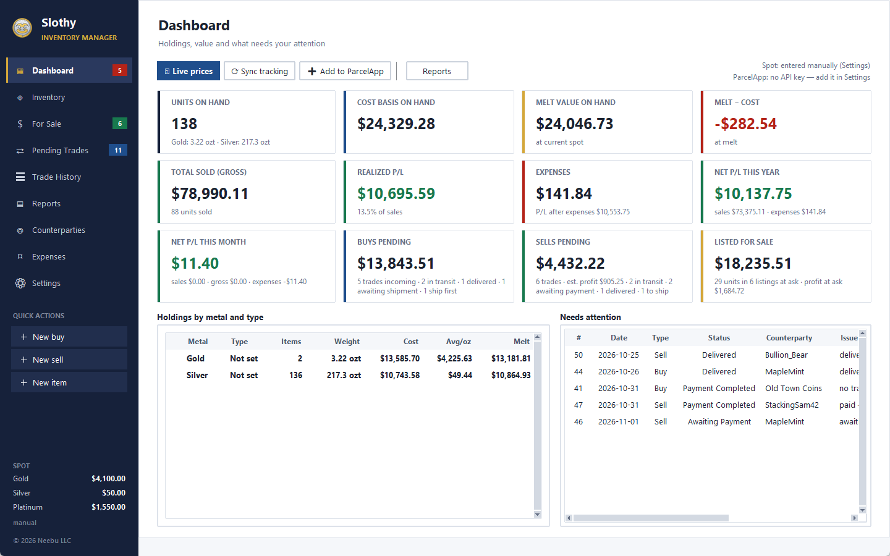

*The Dashboard (practice data): value cards across the top, holdings by metal, and the trades that need you under Needs attention.*

- **Action row:** ⟳ Live prices, ⟳ Sync tracking, ➕ Add to TrackingApp and Reports, with spot price and tracking
  status on the right.
- **Cards:** units, cost basis, melt value, melt − cost, total sold, realized P/L, expenses, net P/L this year and this
  month, buys pending (value on the way), sells pending (value and estimated profit) and listed for sale (value and
  profit at your asking price). **Cash** appears once the book has money in / out entries (see
  [Separate books](#separate-books-a-partners-money-a-personal-collection)); click it to open them.
- **Holdings by metal and type:** one row per metal with items on hand, weight, cost, average cost per ounce and melt.
  ▸ opens its types.
- **Needs attention:** open trades that are waiting on a step from you.

## Inventory

Every item has a metal, name, mint, weight, grade and, optionally, a serial number, type and picture.

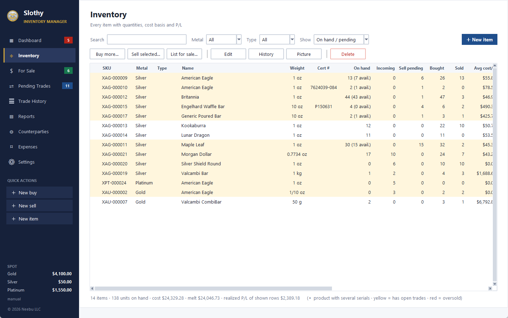

*Inventory: yellow rows have open trades. *On hand* shows how many are still available in brackets when some are promised on an open sell, e.g. 13 (7 avail.).*

### Weights and ounces

Enter the **Weight** as a number (fractions like `1/10` are fine) and pick the **Unit**: `oz`, `g`, `kg` or `lb`. The
app converts everything to ounces as you type:

| Metal | "oz" means | Shown as |
|---|---|---|
| Gold, silver, platinum, palladium | troy ounce (31.1035 g) | `ozt` |
| Copper | regular (avoirdupois) ounce (28.3495 g) | `oz avdp` |

So a 1 kg silver bar is 32.15 ozt, and a 1 kg copper bar is 35.27 oz avdp. Melt value uses the matching spot price.

### Products and serials

Every serialised bar or coin is its own item, with its own cost, listing and history. Items with a serial that share
metal, name, mint, weight and grade count as one **product**.

- **On Inventory**, a product shows as one bold row with totals. ▸ opens it to list each serial.
- **Buying more:** select the product and click **Buy more…**, then type or paste the new serials, one per line or
  separated by commas. The quantity follows the number of serials.
- **Selling:** select serial rows (Ctrl- or Shift-click for several) and click **Sell selected…**. Or select the
  product row and pick its serials from a list.
- **Editing:** Edit on a product row changes all its serials. Edit on one serial changes just that one, unless you tick
  *apply to all*.
- **Serials you find out later:** buy the item without serials (for example, quantity 2), then **Edit** it and type its
  serials, comma-separated, in *Cert / serial no*. It becomes one item per serial, grouped as a product, and the cost
  doesn't change. If some are still on the way, type just the ones you have; add the rest when they arrive.
- **Serial ranges:** `1984-2000` means all 17 serials from 1984 to 2000. `P0098-P0102` (or `P0098-0102`) keeps the
  prefix and leading zeros. Mix ranges and single serials with commas. If a prefix itself ends in a dash, repeat it:
  `PAMP-1234-PAMP-1240`.

### Item types, pictures and cost

- **Type:** Vintage, Modern, Art, Generic, Sovereign or Pour, or type your own. Set it in **Edit**. Inventory can filter
  by type (*Not set* finds items without one). It doesn't affect prices or P/L.
- **Picture:** paste a web link to the item's photo into *Picture URL* in **Edit**. **Picture** on Inventory opens it.
  Serials of a product share one picture, and a serial can have its own instead.
- **Cost:** an item bought in the app gets its cost from its buys. To change it, change the buy. An item imported from
  your spreadsheet without a cost can be given one in **Edit** (*Cost / unit*).
- **Deleting:** Delete removes an item, but only if it isn't on any trade other than its import. Otherwise the message
  lists the trades it's on.

## Buying and selling

Start a trade from the **Trade** menu, the Quick actions or the buttons on each page. Pick existing items (or
*New item…* on a buy), set the quantity and the unit price, and choose the counterparty.

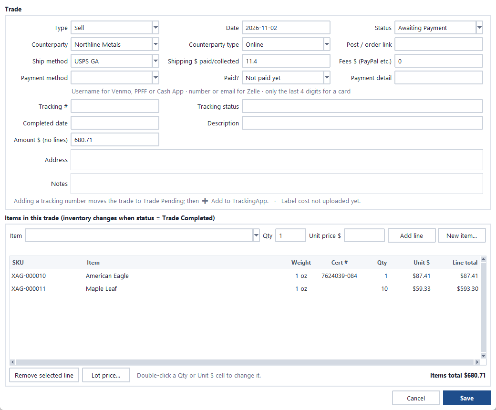

*A sell in the trade window: the trade's details at the top, its items below. Inventory only changes once the status is Trade Completed.*

| Step | Buy | Sell |
|---|---|---|
| 1. Create | pick items, set qty and unit price | pick items, set qty and sell price |
| 2. Starting status | **Ship First/Trade** or **Payment Completed** (default) | **Awaiting Payment** (default), then **$ Payment Completed** |
| 3. Tracking added | status becomes **Trade Pending**; click **➕ Add to TrackingApp** when ready | same |
| 4. In transit | a tracking sync updates the status and expected date | same |
| 5. Delivered | sync sets **Delivered** (the row turns green); check the item | sync sets **Delivered**; confirm with the buyer |
| 6. Complete | **✔ Trade Completed** (never automatic) | same |
| 7. Result | moves to **Trade History**; on hand and average cost updated | moves to **Trade History**; on hand reduced, sale and P/L recorded |
| Lost in the mail | **Lost/No Refund**: nothing added, cost written off as a loss | **Lost/No Refund**: items leave inventory, booked as a sale |

- **Changing items on a trade:** open it, select a line and click **Remove selected line** (or press Delete), then pick
  another item and **Add line**. Double-click a Qty or Unit $ cell to change just that. **Save** applies the changes;
  **Cancel** leaves the trade as it was.
- **Payment method and detail:** pick Zelle, Venmo, PPFF, Cash App, Credit Card or Cash, or type another. The detail is
  the username, phone or email. For a card, enter only the last 4 digits; the app refuses a full card number.
- **Paid or not:** **Paid?** on the trade follows the status at first and then stays as you set it, so adding tracking
  to an unpaid trade doesn't make it look paid. An unpaid trade shows **· unpaid** and appears under *Needs attention*.
  **$ Payment Completed** (Pending Trades) or *Mark paid* (Trade History) clears it.
- **Counterparty box:** start typing to pick someone you've traded with. Their type and address are filled in. A new
  name is saved as a counterparty with the trade.

## Pending Trades

Your open trades. Right-click a trade (or use **More ▾**) for the less common actions.

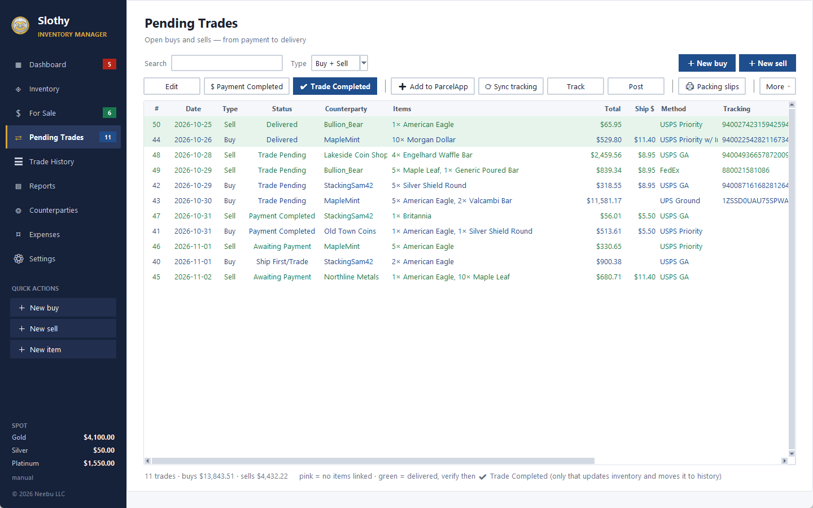

*Pending Trades: green rows are delivered and waiting for you to check the package and click ✔ Trade Completed.*

- **Partly delivered…:** when only part of a trade arrives (or ships), enter how many of each line arrived. That part
  is completed on the original trade, and the rest moves to a new open trade with the same details. Add the second
  tracking number to the new trade when it ships.
- **Lost/No Refund**, **Cancel trade** and **Delete…** end or remove a trade.

### Packing slips (4x6 labels)

**🖨 Packing slips** lists the open sells that haven't been delivered yet, with the ones you had selected already
ticked. **Print selected** opens a 4x6 page in your browser with its print dialog:

- Each sell is a slip: **username · name · tracking**, then one line per item (qty, weight and name, grade, serial).
- As many slips as fit go on each label, with a dashed ✂ cut line and a little space between them. A slip is never
  split across two labels.
- Print to your label printer at **4x6, scale 100%**.

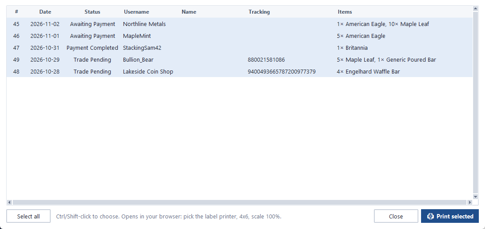

*Pick the sells to pack. The ones you had selected in Pending Trades are already chosen.*

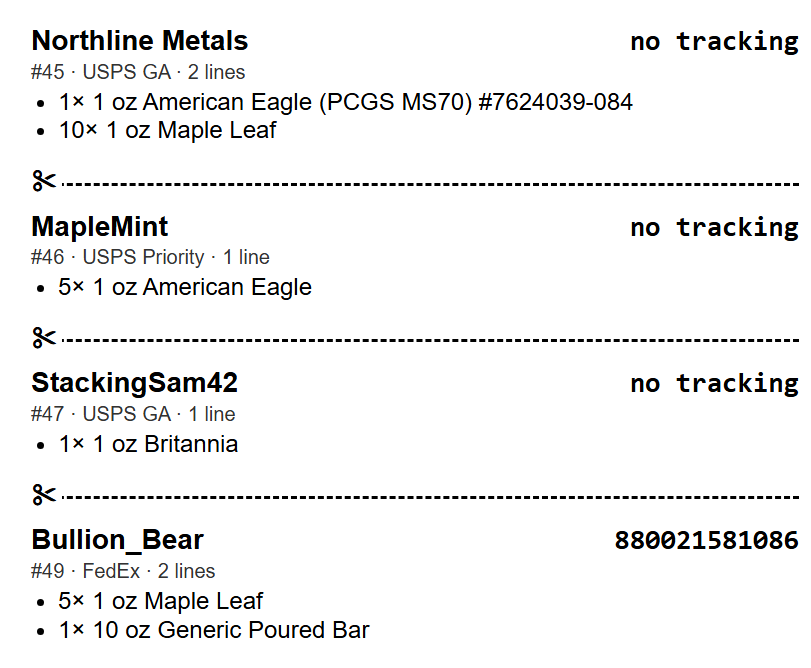

*Four sells on one 4x6 label: username, tracking (or *no tracking* yet), then one line per item, with a ✂ cut line between slips.*

## Trade History

Finished trades. A From / To date range applies to both views:

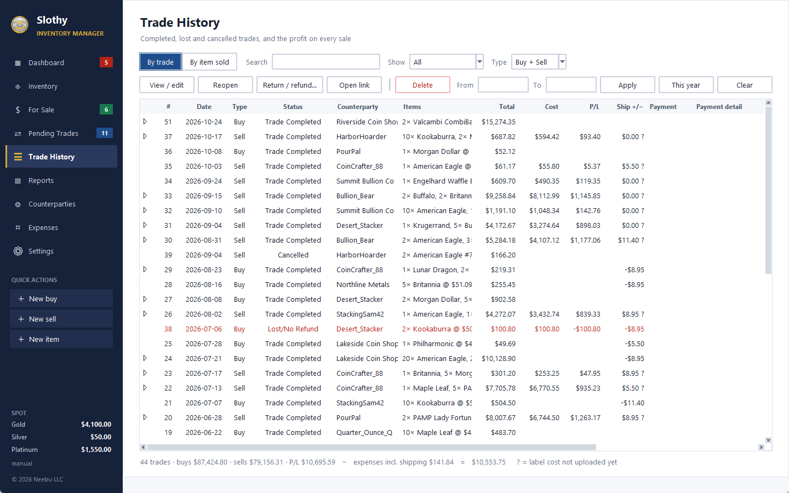

**By trade*: one row per trade with its cost, P/L and shipping result. Red rows lost money (here, a lost buy). **?** in Ship +/− means the label cost hasn't been uploaded yet.*

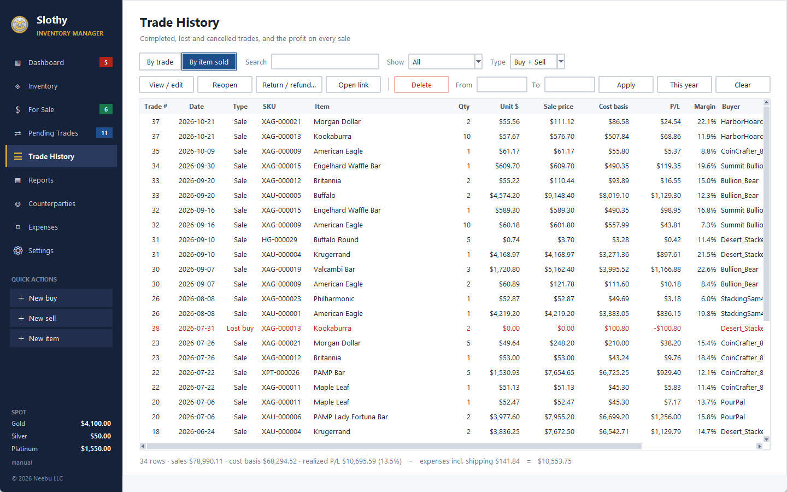

**By item sold*: one row per item sold, so you can sort every sale by item, margin or buyer.*

- **By trade:** one row per trade, buys and cancelled trades included. ▸ opens a trade's items, each with its own
  price, cost and P/L. Search also finds items and serials inside a trade.
- **By item sold:** one row per item sold, with qty, unit price, sale price, cost, P/L, margin and buyer, so you can
  sort every sale across trades.

A trade or item that lost money is red. The footer totals what's on screen; with no filter it also subtracts the
expenses for the date range to give net P/L.

- **Reopen** sends a trade back to Pending Trades and undoes its effect on inventory. Finishing it again asks whether
  to keep its original completed date.
- **Return / refund…** records what happened after a trade finished, on its own date, so the original month stays as
  it was. A trade with one shows **↩**. Remove the return before reopening the trade or changing its items.

| What happened | Enter | Effect |
|---|---|---|
| Buyer returned units | units and the refund | units back on hand at their cost; the sale is reversed |
| Partial refund, buyer kept the item | refund only | sale price goes down |
| You sent units back to the seller | units and the refund | units leave at average cost; any difference is a gain or loss |
| Seller refunded part, you kept the item | refund only | lowers the cost of what's on hand |
| Money back on a lost buy | money back | reduces the amount written off |
| Lost sell: you refunded the buyer | refund | reverses the sale |
| Insurance paid out | amount received | income against what was written off |

## Package tracking

The app adds your tracking numbers to a package-tracking service and reads back their delivery status, so you
can follow packages in that service's own app on your phone too. Pick the service in Settings → *TrackingApp*
→ *Service* and paste its API key underneath. Integrations with several services are in progress and will be
completed over time; the *Service* list shows which ones are ready.

- The app syncs once when it opens and whenever you click **⟳ Sync tracking**. To sync on its own as well, set
  Settings → *TrackingApp* → *Sync tracking* to **Every hour** or **Every 2 hours** (off by default).
- Each service limits how many numbers you can add a day and how often you can sync. The app counts its own calls
  and won't make one that would go over, so an add is never wasted. Settings shows how many you've used.
- Saving a tracking number sets the trade to **Trade Pending** but doesn't add it to the service yet. The trade
  shows "not added" until you click **➕ Add to TrackingApp**, which adds the selected trades (or all waiting ones)
  after you confirm.
- A sync marks as added any number the service already has, so numbers you added in the service's app yourself
  don't need adding again.
- A failed add (for example, a mistyped number) isn't retried by itself; it shows under *Needs attention*.
- The carrier comes from the shipping method: UPS, FedEx, otherwise USPS.
- **Only the bare minimum leaves the app:** the tracking number, the carrier and a short delivery name. Never the
  counterparty, address, items or prices, whichever service you use.
- **Delivery names:** a delivery is named only with a short label for buys or sells and the trade number, so the
  service never holds what's in a package or who it's for. Set your own labels in Settings → *TrackingApp* →
  *Delivery names*: something you'll recognise in the tracking app on your phone (an arrow or a symbol works well),
  not a word like Buy, Sell or Gold. Leave them blank for just the trade number. The number matches the trade in
  Pending Trades.

## For Sale

Everything you've listed for sale and can still sell, with qty, asking price, cost, profit at ask, margin and premium
over melt.

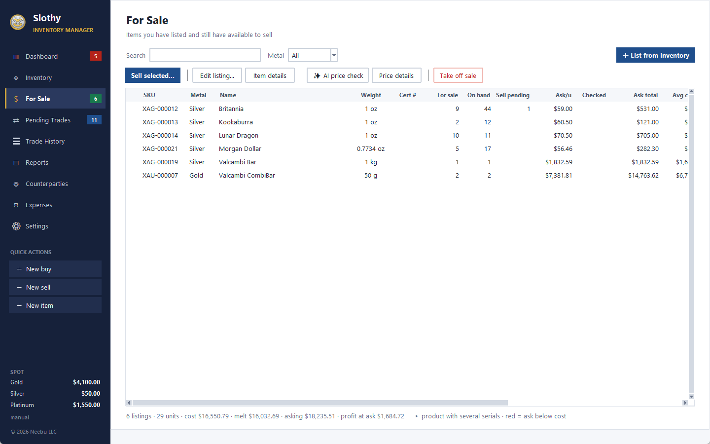

*For Sale: what's listed and can still be sold. *For sale* is what's left after open sells use up the listing.*

- **To list:** select items on Inventory and click **List for sale…**, then enter the quantity and the asking price per
  unit. Select several to list them all at one price; leave the price blank to keep each item's own.
- **Colors:** yellow rows have no asking price yet; red rows are asking less than they cost.
- **Sell selected…** starts one sell for the selected listings, with their quantities and prices filled in.
  Double-click a Qty or Unit $ cell to change it. **Lot price…** splits one agreed total across the lines in
  proportion to their value. Anything you don't sell stays listed.
- An open sell uses up the listing first: list 5, start a sell for 2, and 3 show as for sale. When the sell is
  completed, those units come off the listing. You can never list more than you have available.
- **Take off sale** removes the listing.
- **✨ AI price check** looks up current prices; see [AI features](#ai-features).

## Counterparties

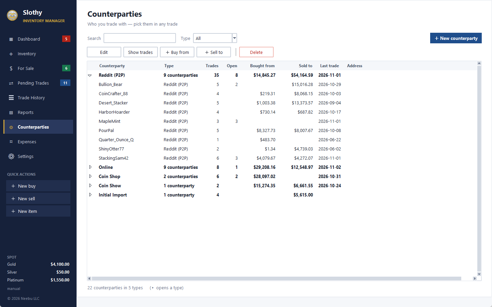

*Counterparties, grouped by type with totals. ▸ opens a type to list everyone in it.*

Everyone you trade with, grouped by type: Reddit (P2P), eBay, Whatnot, Online (dealers), Coin Shop, Coin Show, and
Initial Import for sales imported from your spreadsheet. Each shows its address, number of trades, open trades,
amounts bought and sold, and last trade date.

- Everyone on a trade is added automatically, with the address from their latest trade.
- Common dealers (APMEX, BOLD, JM Bullion, Monument Metals, SD Bullion, Scottsdale Mint, Costco) are already
  listed. Delete any you don't use.
- Renaming a counterparty renames them on all their trades. Someone with trades can be renamed but not deleted.
- **Show trades**, **＋ Buy from** and **＋ Sell to** start from the selected counterparty.

## Expenses and shipping labels

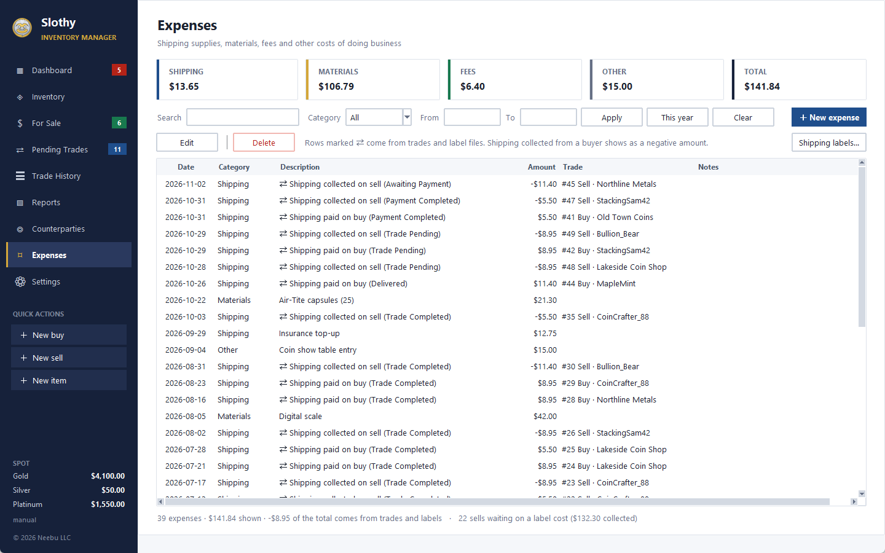

*Expenses: ⇄ rows come from trades and label files. Shipping collected from a buyer shows as a negative amount, because it offsets what you spent.*

The **Expenses** page records costs that aren't part of a trade: Shipping (mailers, postage), Materials (capsules,
flips), Fees and Other. Each expense can be linked to a trade.

- Shipping and fees typed on a trade show up here automatically as ⇄ rows. Don't enter them again by hand.
- They never change an item's cost or a sale's price, but they're included in P/L after expenses.

### Shipping labels

On a trade, **Shipping $** is what you paid on a buy and what you collected from the buyer on a sell (0 for free
shipping). What a label really cost comes from your label provider's export file:

| Trade | Shipping $ | Label cost | Shipping gain or cost |
|---|---|---|---|
| Buy | 12 paid | none | −$12 |
| Sell, buyer paid | 10 collected | 8 | +$2 |
| Sell, free shipping | 0 | 8 | −$8 |
| Sell, label not uploaded yet | 10 collected | waiting | +$10, marked **?** |

- **Expenses → Shipping labels… → Upload label file…** reads an `.xlsx` or `.csv` export with tracking numbers and
  costs. A Pirate Ship export works as it is. Upload the same or a newer file any time; your decisions are kept.
- Each label goes to the trade with the same tracking number. Refunded labels are never counted.
- A label that matches no trade isn't in your P/L until you choose: *Link to a trade…*, *Count as expense* or
  *Don't count*.
- Trade History's **Ship +/−** column shows the result per trade.

## Reports

Profit and loss month by month, for one year or all years (Ctrl+6).

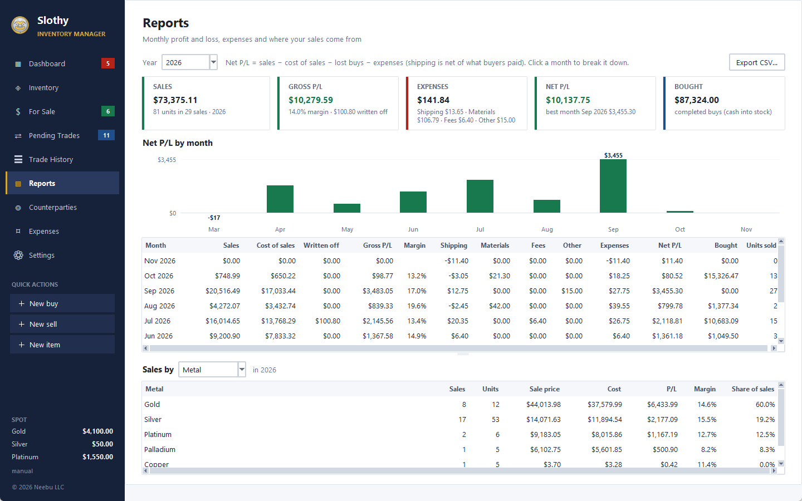

*Reports: the year's totals, net P/L per month (click a bar to break that month down), the monthly table and sales by metal.*

- **Cards:** sales, gross P/L, expenses, net P/L and money spent on buys.
- **Chart:** net P/L per month, green above zero and red below. Click a bar to break that month down.
- **Monthly table:** sales, cost of sales, lost buys written off, gross P/L and margin, each expense category, net
  P/L, buys and units sold. Net P/L = sales − cost of sales − lost buys − expenses.
- **Sales by:** a breakdown by metal, channel, counterparty or item, with P/L, margin and share of sales.
- **Export CSV…** saves the monthly table.

Sales count in the month they were completed, and open trades don't count until they're completed. Sales imported
from your spreadsheet have no date, so they show as **Undated** under All years.

## AI features

Both use Google's Gemini and run only when you click their buttons. Create a free API key at
[aistudio.google.com/apikey](https://aistudio.google.com/apikey) and paste it into **Settings**. (A Gemini app or
Google AI Pro subscription doesn't include an API key.) Settings shows this month's usage.

- **Import any spreadsheet with AI** (File menu, into an empty database): Gemini reads the first 25 rows of each sheet
  and works out which column is which. You review and adjust the result, try it with **Preview**, then **Import**. The
  rest of your data is never sent to Google. On the free tier, Google may use what it's sent to improve its products,
  including any names or addresses in those 25 rows.
- **✨ AI price check** (For Sale): select up to 10 listings, and Gemini searches the web for dealer prices and recent
  sales, with links. Its suggested price shows in the **AI est./u** column, and **Price details** shows the sources with
  a *Use as ask* button. These are estimates, so check the links. Web search needs a paid-tier key (turn on billing in
  AI Studio); the first 5,000 searches a month are free.

## Separate books (a partner's money, a personal collection)

A *book* is one database file. Keep money that must stay apart, such as a partner's investment, in a book of its own:
its stock, average costs, profit and expenses never mix with your main one.

1. **Make the book:** **File → Switch book → Open / new book…**, type a name such as `Partner-Investment` and
   click Save. The app opens the new, empty book.
2. **Record the money put in:** **Trade → Money in / out…** → *Put in*, the amount and a note → **Add**.
   A **Cash** card then appears on that book's Dashboard.
3. **Trade as usual,** but only with that money. Record its buys, sells and expenses in that book, and keep the
   metal itself apart too (a labelled box), so a piece is never shipped against the wrong book's sale.
4. **Switch between books:** **File → Switch book** lists the books you've opened, or click the **BOOK** box at the
   top of the sidebar. The open book's name is shown there and in the title bar: check it before you save a trade.
5. **Split the profit:** that book's **Reports** and Dashboard show its realized P/L and expenses. A payout is
   **Money in / out… → Taken out**.

**Cash** is what the book's money should be: put in − taken out − buys paid + sales received − expenses, plus
refunds and insurance received (less refunds given). A trade counts once it's paid, and a cancelled one doesn't. The
app doesn't see your bank account, so compare it with the real balance now and then. A separate bank or PayPal
account for the book makes that easy.

**Moving pieces between books** (for example, splitting off a personal collection): on the **Inventory** page,
select the pieces (Ctrl/Shift-click for several) and click **Move to book…**. Pick the book (a new
`personal-collection` book is offered the first time), set how many units of each to move, and click **Move**.
They move at their average cost: this book shows a *Moved out* entry in Trade History with no sale and no profit or
loss, and the other book gets a *Moved in* buy at the same cost. No money moves, so cash, sales and profit stay as
they were, and the pieces' past trades stay in the book they were made in. Moving a piece back works the same way.

## Settings, backups and your data

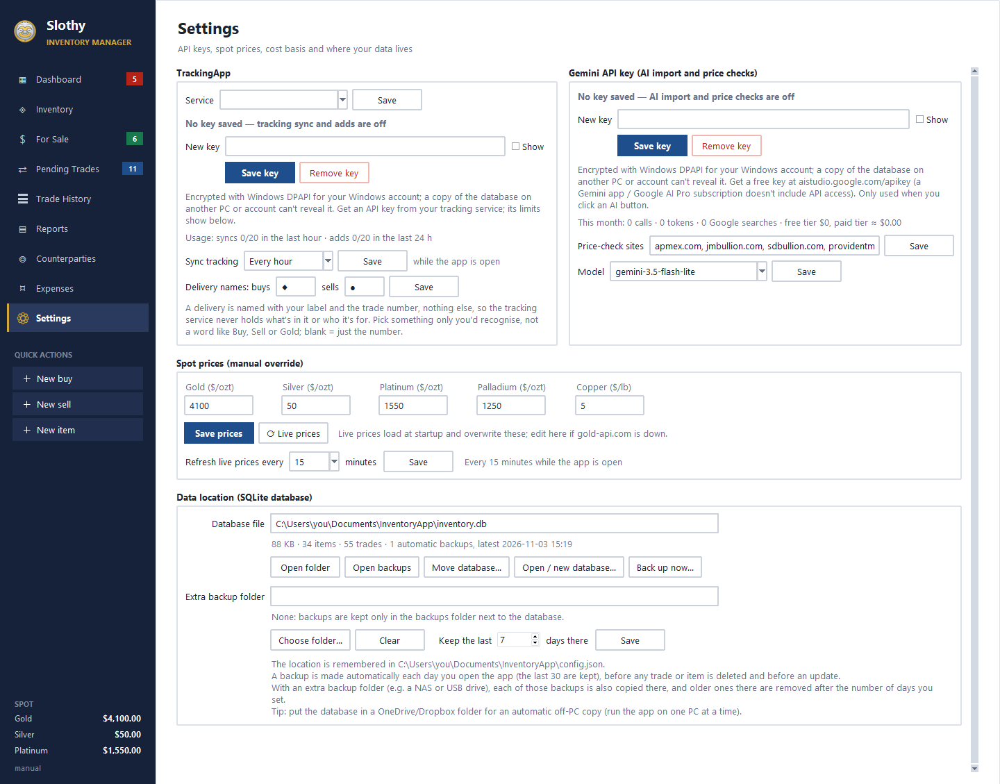

*Settings: API keys and the tracking timer, spot prices and their refresh, and where your data and backups go.*

- **API keys** (tracking service, Gemini) are stored encrypted so that only your Windows account on this PC can read them. The
  box is never pre-filled; paste a new key and click *Save key*, or *Remove key*.
- **Spot prices:** type prices by hand if live prices aren't available. *Refresh live prices every … minutes*
  fetches them on its own while the app is open: 5 minutes or more, or **Off** (the default: only when the app
  opens and on ⟳ Live prices).
- **TrackingApp:** pick the *Service* (more integrations are in progress), paste its key, and set *Sync
  tracking* to **Off** (the default), **Every hour** or **Every 2 hours**, and your *Delivery names*.
- **Automatic backups:** a copy of your database is saved in a `backups` folder next to it each day you open the app
  (last 30 kept), before anything is deleted (last 20) and before each update (last 10). *Open backups* shows them. To
  restore one, close the app and copy it over `inventory.db`, or use **File → Open / new database…**.
- **Extra backup folder:** Settings → Data location → *Extra backup folder* → **Choose folder…** (for example a
  NAS share or a USB drive). Every automatic backup is then also copied there. *Keep the last … days there*
  (7 by default) removes older ones from that folder so it doesn't fill up. Leave the folder blank to keep backups
  only next to the database. If the folder can't be reached, your normal backup is still
  made, the app tells you, and today's copy goes there the next time the app opens. **Clear** turns it off.
- **Data location:** shows where your database is, with *Open folder*, *Move database…*, *Open / new database…* and
  *Back up now…*. The app remembers the location. If that folder is missing (for example, an unplugged drive), it
  warns you and opens the default one.
- **Errors:** an unexpected error shows a message and is saved to `error-log.txt` in `Documents\InventoryApp`.
- **Moving to a new PC:** copy `inventory.db` across. API keys can't be read on another PC or Windows account, so enter
  them again in Settings.

## Importing your spreadsheet

**File → Import from Excel workbook or CSV files…** imports a workbook laid out like the original Metals spreadsheet.
For any other layout, use **Import any spreadsheet with AI…** (see [AI features](#ai-features)).

- **Items** (and **Copper**): each item and what it cost, as an opening balance from *Initial Import*. When you know
  who you bought something from, edit that buy to set the counterparty and date. Cost and quantities stay the same.
- **Sold:** each row becomes a completed sale from *Initial Import* in Trade History. It counts in P/L but not in
  what's on hand. These sales have no date. You can move them to the right counterparty by editing them.
- **Pending Transactions:** imported as open trades with their details, but without items (the sheet doesn't say
  which ones). They show pink: open each, add its items, then complete it. If its items are already on the Items
  sheet, they're already counted, so don't add them again.
- **LivePrice:** spot prices.

**File → Export to Excel…** saves everything back out to a workbook.

## Shortcuts

| Keys | Does |
|---|---|
| Ctrl+1 … Ctrl+9 | Dashboard, Inventory, For Sale, Pending Trades, Trade History, Reports, Counterparties, Expenses, Settings |
| Ctrl+B | New buy |
| Ctrl+S | New sell |
| Ctrl+N | New item |
| Delete | Remove the selected line in a trade |

Updates: **Help → Check for updates…**. Your version: **Help → About**.
