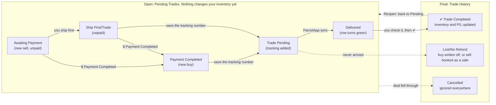

# Slothy Inventory Manager: setup and daily workflow

Slothy Inventory Manager is a Windows desktop app. It tracks your bullion inventory, every buy and sell, shipping, and
profit. The one rule to remember: **quantities are never typed in.** They come from trades, and only a trade marked
**Trade Completed** (or Lost/No Refund) changes inventory or P/L.

For a page-by-page reference, see the [user guide](GUIDE.md).

- [How it works](#how-it-works)
- [Getting up and running](#getting-up-and-running)
- [Pages](#pages)
- [Workflows](#workflows): [buying](#buying), [selling](#selling), [a worked example](#a-worked-example),
  [partly delivered](#partly-delivered), [when things go wrong](#when-things-go-wrong), [serials](#serials),
  [listing for sale](#listing-for-sale), [shipping and ParcelApp](#shipping-and-parcelapp), [expenses](#expenses),
  [shipping labels](#shipping-labels), [reports](#reports), [counterparties](#counterparties)
- [Daily and weekly routine](#daily-and-weekly-routine)
- [Troubleshooting and rules of thumb](#troubleshooting-and-rules-of-thumb)

## How it works

Everything runs on your PC. Your data lives in one file (`inventory.db`), and API keys are stored encrypted for your
Windows account. The app goes online only when it opens and when you click a button: ParcelApp for tracking,
gold-api.com for spot prices, Gemini for the optional AI features, and GitHub to check for app updates.

| Concept | What it means |
|---|---|
| **Item** | One product (e.g. a 10 oz Engelhard bar), or one serialised piece. Has metal, weight and unit, mint, packaging, cert details, notes and a picture link. Its SKU looks like `XAG-000123`. |
| **Product** | Serialised items with the same metal, name, mint, weight and grade. Inventory folds them under one bold row. |
| **Trade** | A Buy or a Sell, with a counterparty, date, item lines (qty × unit price), shipping, fees, tracking and status. |
| **Status** | Where a trade is in its workflow: open (Pending Trades) or final (Trade History). See [Workflows](#workflows). |
| **Counterparty** | Who you trade with. Its type (Reddit (P2P), eBay, Whatnot, Online, Coin Shop, Coin Show) decides its ParcelApp name. |
| **Your numbers** | Worked out again on every refresh from all final trades: on-hand qty, average cost, sold qty, revenue, cost of goods sold, realized P/L. |
| **Expenses** | Shipping, materials, fees and other costs. Never part of an item's cost; subtracted from P/L in Trade History and Reports. |

**Cost method: weighted average.** Every completed buy adds its qty and cost to the item. The average cost per unit is
total cost ÷ units on hand. A sale's cost basis is qty sold × the average cost at that moment, and its P/L is sale price
− cost basis.

**Shipping and fees are expenses, not cost.** The Shipping field on a trade is what you paid on a buy and what you
collected from the buyer on a sell. Both flow to Expenses, with money collected counting against shipping costs.
Neither changes unit cost or sale price.

**Melt** = ounces on hand × today's spot. Gold, silver, platinum and palladium use troy ounces. Copper uses avoirdupois
ounces and spot $/lb ÷ 16.

## Getting up and running

Setup takes about 15 minutes: install the app, add two keys, check spot prices, and make a backup.

1. **Install the app.** Download `SlothyInventorySetup-<version>.exe` from the
   [latest release](https://github.com/arpspatel/slothy-inventory-releases/releases/latest) and run it. If Windows shows
   a SmartScreen warning, click **More info** → **Run anyway**; it appears because the installer isn't code-signed.
   Choose **Install for me only** (no admin rights needed) or **Install for all users**. Then open the app from the
   Start menu or the desktop shortcut.
2. **Your database.** On first launch the app creates `Documents\InventoryApp\inventory.db` and offers to import an
   existing workbook; choose No to start empty. Settings → *Data location* shows the file in use, with
   **Open folder**, **Move database…**, **Open / new database…** and **Back up now…**.
3. **Add the ParcelApp key.** Get it at web.parcelapp.net (needs Parcel Premium). Settings → *ParcelApp API key* →
   **New key** → **Save key**. Limits: 20 syncs an hour, 20 adds a day.
4. **Add the Gemini key (optional).** Only needed for AI spreadsheet import and ✨ AI price check. Create it free at
   [aistudio.google.com/apikey](https://aistudio.google.com/apikey). Web-search price checks need a paid-tier key. Set
   your preferred price-check sites underneath.
5. **Check spot prices.** Live prices load when the app opens. If they can't be fetched, type them in Settings →
   *Spot prices* → **Save prices**. Copper is $/lb; the others are $/troy oz.
6. **Back up.** Click **Back up now…**. Better still, put the database in a OneDrive or Dropbox folder with
   **Move database…** for an automatic off-PC copy. The app also saves its own copies in a `backups` folder next to
   the database (each day you open it, before any delete and before each update). To keep a second copy off this
   PC too, set Settings → *Extra backup folder* → **Choose folder…** (a NAS share or a USB drive): every automatic
   backup is also copied there.

Keys are encrypted for your Windows account. A copy of the database on another PC or account won't carry working keys;
enter them again there.

**Updates are automatic.** The app checks for a new version once a day (or from **Help → Check for updates…**), shows
what's new and asks first. **Update now** backs up your data, installs the update and reopens the app. To remove the
app, use Windows Settings → Apps → Installed apps. Your database stays in `Documents\InventoryApp` until you delete it
yourself.

## Pages

Nine pages sit in the left-hand sidebar (Ctrl+1 to Ctrl+9). Pending Trades is where you work each day; the rest are
for looking things up and reporting.

| Page | Use it for | Key actions |
|---|---|---|
| **Dashboard** | Holdings at a glance: units, cost basis, melt, melt − cost, total sold, realized P/L, expenses, net P/L this year and this month, buys pending, sells pending (with estimated profit), listed for sale (value and profit at ask). Holdings by metal (items, weight, cost, average cost per ounce, melt), with ▸ to open each metal's types; metals aren't added together. *Needs attention* list. ParcelApp and spot status. | ⟳ Live prices, ⟳ Sync tracking, ➕ Add to ParcelApp, Reports |
| **Inventory** | Every item with on hand, incoming, sell pending, bought, sold, avg cost, on-hand cost, sold $, realized P/L, ounces, melt and for sale. Products with several serials fold under a bold row (▸). Yellow = has open trades; red = oversold. Type (Vintage, Modern, Art, Generic, Sovereign, Pour or your own) has its own column and filter. | ＋ New item, Buy more…, Sell selected…, List for sale…, Edit, History, Picture, Delete |
| **For Sale** | What you have listed and can still sell: qty for sale, ask, cost, profit at ask, margin, over melt. Products fold under a bold row; select it to act on all its serials. Yellow = no ask price; red = ask below cost. | Sell selected…, Edit listing…, Item details, ✨ AI price check, Price details, Take off sale |
| **Pending Trades** | Open buys and sells, from payment to delivery. Pink = no items linked; green = delivered. | ＋ New buy / sell, Edit, $ Payment Completed, ✔ Trade Completed, ➕ Add to ParcelApp, ⟳ Sync tracking, Track, Post, 🖨 Packing slips, More (Partly delivered, Lost, Cancel, Delete) |
| **Trade History** | Finished trades (completed, lost, cancelled) and the profit on every sale. *By trade*: one row per trade with total, cost, P/L, shipping gain or cost, payment and tracking. *By item sold*: one row per item with qty, sale price, cost basis, P/L, margin, buyer, payment. Footer: P/L − expenses = net. | By trade / By item sold, View / edit, Reopen, Return / refund…, Open link, Delete, From / To, This year |
| **Reports** | Month-by-month P&L for a year or all years: sales, cost of sales, lost buys, gross P/L, each expense category, net P/L, buys. Chart of net P/L per month. Sales broken down by metal, channel, counterparty or item. | Year, click a month or bar, Sales by, Export CSV… |
| **Counterparties** | Everyone you trade with, grouped by type with totals (counterparties, trades, open, bought from, sold to, last trade). ▸ opens a type. | ＋ New counterparty, Edit, Show trades, ＋ Buy from, ＋ Sell to, Delete |
| **Expenses** | Shipping, materials, fees, other. Shipping and fees from trades, and label costs from uploaded files, show here automatically. Totals by category. | Add, edit, delete; date filter; Shipping labels… |
| **Settings** | API keys, price-check sites, manual spot prices, data location and backups (with an optional extra backup folder), API usage. | Save key, Save prices, Move database…, Back up now…, Open backups, Choose folder… |

**By trade vs By item sold.** By trade includes buys, cancelled trades and shipping details. By item sold has only
sales and lost trades, so you can sort every sale by item or margin across trades. Both use the same numbers, so the
totals agree. For month-by-month totals, use Reports.

Double-click a row almost anywhere to open it. Click a column header to sort; grouped pages sort the groups and the
rows inside each group.

## Workflows

Every buy and sell follows the same path: create it, move it through payment and shipping, and mark it
**Trade Completed** yourself once the metal is in hand or the buyer confirms. Nothing completes automatically.

Sells start at **Awaiting Payment** and buys at **Payment Completed**. Saving a tracking number moves either to
**Trade Pending**, and a ParcelApp sync marks **Delivered**. Only the three statuses on the right are final.

While a trade is open, a buy counts as **Incoming** and a sell as **Sell pending**. A pending sell stays on hand but is
no longer *available*, so it can't be sold twice. **Reopen** in Trade History sends a trade back to Pending and undoes
its effect.

| Inventory column | What it counts |
|---|---|
| **On hand** | Units from completed buys, minus units from completed sells |
| **Incoming** | Units on open buys |
| **Sell pending** | Units on open sells (still on hand until the sell is completed) |
| **Available** | On hand − sell pending: what you can still offer someone else |
| **For sale** | Units you've listed, after open sells use them up; never more than available |

### Buying

1. Pending Trades → **＋ New buy** (Ctrl+B), or Inventory → select the item → **Buy more…**.
2. Pick or type the counterparty and its type. A new name is registered automatically.
3. Add lines: pick an item (or *New item…*), qty, unit price → **Add line**. For a serialised product, pick the ▣
   product entry and type the serials, one per line, comma-separated or as a range (`1984-2000`); qty follows the
   count. For a lot at one total price, add the lines and use **Lot price…** to split it.
4. Enter the shipping you paid and any fees. These go to Expenses, not item cost.
5. Status starts at **Payment Completed** (or choose **Ship First/Trade** if you haven't paid yet). Save. The items
   now show as **Incoming**.
6. When the seller sends tracking, edit the trade, paste it and choose the shipping method. Status becomes
   **Trade Pending**.
7. Click **➕ Add to ParcelApp** (see [Shipping and ParcelApp](#shipping-and-parcelapp)). Syncs update the status;
   delivery turns the row green.
8. Check the package, then **✔ Trade Completed**. On-hand qty and average cost update, and the trade moves to Trade
   History.

To change an item on a trade, select its line and use **Remove selected line** (or press Delete), then add the new
one.

### Selling

1. Pending Trades → **＋ New sell** (Ctrl+S), or Inventory / For Sale → select items → **Sell selected…**. For a
   product, you pick which serials go (listed ones first).
2. Set qty and sale price per unit, the counterparty, and the shipping you collected from the buyer (0 for free
   shipping or an offer that includes it). Save. The items now show as **Sell pending**.
3. Status starts at **Awaiting Payment**. When paid, click **$ Payment Completed**.
4. Print a packing slip (Pending Trades → **🖨 Packing slips**), pack and ship, add the tracking number, then
   **➕ Add to ParcelApp**.
5. After delivery and the buyer's confirmation, **✔ Trade Completed**. The sale, cost basis and P/L are recorded, on
   hand goes down, and the listing goes down by the qty sold.

**Payment method and detail.** On any buy or sell, pick how the money moved: Zelle, Venmo, PPFF, Cash App, Credit Card
or Cash, or type another. In *Payment detail*, enter the username for Venmo, PPFF or Cash App, or the number or email
for Zelle. For a card, enter only the last 4 digits; the app refuses a full card number. Both show in Trade History,
and search finds them.

**Paid or not.** *Paid?* on the trade form follows the status at first, then stays as it is, so adding tracking to an
unpaid trade doesn't make it look paid. It shows **· unpaid** in the status and under *Needs attention* until you
click **$ Payment Completed** on Pending Trades or *Mark paid* in Trade History's right-click menu. Completing an
unpaid trade asks whether to mark it paid or keep showing the payment as owed.

**Packing slips.** **🖨 Packing slips** lists the open sells not yet delivered. **Print selected** opens a 4x6 page:
each sell is a slip with **username · name · tracking**, then one line per item. As many slips as fit go on each
label, with a dashed ✂ cut line between them. Print at 4x6, scale 100%.

### A worked example

How one item's numbers move through two buys and a sell:

| Step | On hand | Incoming | Sell pending | Available | Total cost on hand | Avg cost/u |
|---|---|---|---|---|---|---|
| Save a buy of 10 Silver Eagles at $32 | 0 | 10 | 0 | 0 | $0 | – |
| ✔ Complete that buy | 10 | 0 | 0 | 10 | $320 | $32.00 |
| Buy 5 more at $35, completed | 15 | 0 | 0 | 15 | $495 | $33.00 |
| Save a sell of 6 at $40 | 15 | 0 | 6 | 9 | $495 | $33.00 |
| ✔ Complete that sell | 9 | 0 | 0 | 9 | $297 | $33.00 |

The completed sell is booked as **sale price $240 − cost basis $198 (6 × $33.00) = P/L +$42**. Selling never changes
the average cost of what's left. If 10 were listed for sale, For sale shows 4 once the sell is saved and stays at 4
after it's completed.

### Partly delivered

When only part of a trade arrives (or ships), split it instead of waiting.

1. Pending Trades → right-click the trade (or **More ▾**) → **Partly delivered…**.
2. Enter how many of each line arrived → **Complete arrived part**.
3. That part is completed on the original trade, which keeps its tracking, shipping and fees.
4. The rest becomes a new pending trade: same counterparty, date, link and prices, as Payment Completed with no
   tracking. Each trade's notes point to the other.
5. When the rest ships, add its tracking number to the new trade. When it arrives, complete it as usual.

### When things go wrong

| Situation | Do this | Effect |
|---|---|---|
| Deal falls through before anything moves | More → **Cancel trade** | Ignored everywhere |
| Paid for a buy, nothing arrived, no refund | More → **Lost/No Refund** | Nothing added; cost written off as a loss in P/L |
| Sold item lost in the mail, payment kept | More → **Lost/No Refund** | Items leave inventory; booked like a sale |
| Completed by mistake | Trade History → **Reopen** | Back to Pending, effect undone. Finishing it again offers to keep the original date |
| Buyer returned an item you sold | Trade History → **Return / refund…**: units and refund | Units back on hand; sale reversed in the month of the return |
| Refunded part of a sale, buyer kept the item | **Return / refund…**: refund only | Sale price goes down |
| Sent a purchase back to the seller | **Return / refund…**: units and refund | Units leave at average cost; any difference is a gain or loss |
| Seller refunded part, you kept the item | **Return / refund…**: refund only | Lowers the cost of what's on hand |
| Insurance paid out, or money back on a lost buy | **Return / refund…** on the lost trade | Counts as income against the loss, in the month it was paid |

A trade with a return or refund shows **↩**. Remove the return before reopening the trade or changing its items.

### Serials

- Each serialised bar or coin is its own item with its own cost and history; the same product is a grouped row.
- **Serials known up front:** type them in the buy (above).
- **Serials found out later:** buy the item without serials (e.g. qty 2). When you know them, Inventory → **Edit** the
  item → type all serials comma-separated in *Cert / serial no* → Save. It becomes one item per serial, each keeping
  its buy price. You can enter up to as many serials as units bought, and none can be sold or on a sell yet.
- **Some still on the way:** type just the serials you have (e.g. 17 of 18). They go to the units that arrived, each
  as a new item under the product. The original item keeps the rest, unserialised, on the open buy. When it arrives,
  Edit that item and type its serial; it joins the product.
- **Ranges:** anywhere you type serials, `1984-2000` means all 17, and `P0098-P0102` (or `P0098-0102`) keeps the prefix
  and leading zeros. Mix ranges and single serials with commas. `AB-1234` stays one serial; for a prefix ending in a
  dash, repeat it (`PAMP-1234-PAMP-1240`).
- **Editing a product row** changes all its serials; editing one serial changes only that one unless you tick
  *apply to all*.

**Pictures.** Edit → *Picture URL* holds a web link to the item's photo; Inventory → **Picture** opens it in your
browser. The app stores the link, not the image. All serials of a product share one picture, including new serials. A
serial with its own photo can also have *This serial's picture*, shown instead of the shared one for that piece.

### Listing for sale

1. Inventory → select the item → **List for sale…** → qty and ask price per unit.
2. **Several at once** (e.g. a few serials of one product): Ctrl/Shift-click them, or select the product's bold row for
   all its serials → **List for sale…** → one ask price per unit. Each is listed at everything it has available; leave
   the ask blank to keep each item's own. On For Sale, **Edit listing…** with several rows selected re-prices them
   together.
3. For Sale shows each listing with profit at ask and margin. An open sell uses up the listing first; a completed sell
   takes its qty off automatically.
4. Optional: **✨ AI price check** (up to 10 listings) researches dealer asks and recent sold prices; **Price details**
   shows sources and a *Use as ask* button. Check the links before trusting it.

### Shipping and ParcelApp

- Saving a tracking number never calls ParcelApp. Rows show *not added* until you click **➕ Add to ParcelApp**, which
  adds the selected (or all waiting) trades. Budget: 20 adds a day, failed ones included.
- **⟳ Sync tracking** reads all recent deliveries in one call (20 an hour). It runs when the app opens too. Numbers you
  added in the Parcel app directly are picked up as added.
- Delivery names: `B:10-28/EBY/exampleuser` for Reddit (RDDT), eBay (EBY) and Whatnot (WNOT) counterparties;
  `B:10-28/APMX` for Online, Coin Shop and Coin Show, using the counterparty's 4-character code.
- The carrier comes from the shipping method: UPS, FedEx, otherwise USPS. Failed adds appear under *Needs attention*
  and are never retried automatically.

### Expenses

Shipping and fees on trades appear on Expenses automatically. Add everything else by hand: mailers, flips, capsules,
scales, platform fees. The Trade History footer subtracts all expenses for the chosen date range to give net profit, as
long as no search, status or type filter is on.

### Shipping labels

A sell's real shipping result is what you collected minus what the label cost. The cost comes from your label
provider's export (Pirate Ship and similar).

1. Expenses → **Shipping labels…** → **Upload label file…**, and choose an `.xlsx` or `.csv` with tracking number and
   cost columns. Upload the same file or a newer one any time; your links and decisions are kept.
2. Each label goes to the trade with its tracking number, even if you type the number in later. A label shared by
   several trades is split evenly. Refunded labels are never counted.
3. Trade History's **Ship +/−** column shows the gain or cost per trade. **?** means the label's cost hasn't been
   uploaded yet, so the amount is what you collected so far.
4. Labels on no trade aren't in your P/L until you decide. Select them and choose **Link to a trade…** (a second box,
   for example), **Count as expense** or **Don't count**.

| Trade | Shipping $ on the trade | Label cost | Ship +/− |
|---|---|---|---|
| Buy | $8 paid | none | −$8 |
| Sell, buyer paid shipping | $6 collected | $5.20 | +$0.80 |
| Sell, free shipping | $0 | $5.20 | −$5.20 |
| Sell, label not uploaded yet | $6 collected | waiting | +$6 **?** |

These files include recipients' names, so don't share them.

### Reports

Reports shows how each month went. Pick a year, or All years, at the top.

- **Net P/L** = sales − cost of sales − lost buys written off − expenses, including shipping and fees typed on trades.
- A sale counts in the month it was completed. Open trades don't count until you mark them Trade Completed.
- Hover a bar in the chart to see that month's numbers. Click a bar or a table row to break that month down below;
  select **Total** to go back to the whole period.
- **Sales by** splits sales by Metal, Channel (Reddit, Online, eBay…), Counterparty or Item, with P/L, margin and each
  one's share.
- **Export CSV…** saves the monthly table for your records or taxes.

### Counterparties

- Created automatically from trades. Set the type correctly: it drives the ParcelApp name.
- Online dealers carry a 4-character code (APMEX = APMX, BOLD, JM Bullion = JMBL, Monument Metals = MONU, SD Bullion =
  SDBL, Scottsdale Mint = SCMT, Costco = COST). Change codes in **Edit**.
- **Show trades** jumps to that counterparty's trades; **＋ Buy from** / **＋ Sell to** starts a trade pre-filled.

## Daily and weekly routine

A normal day takes 5–10 minutes: open the app, clear *Needs attention*, move each open trade one step, and record new
deals the moment they're agreed.

### Every day

- [ ] Open the app. It loads spot prices and syncs ParcelApp once when it opens.
- [ ] Dashboard → read *Needs attention* (failed adds, delivered trades waiting for completion, unpaid and unlinked
  trades).
- [ ] Record every deal agreed since yesterday as a new buy or sell, with the counterparty type set.
- [ ] Mark trades paid with **$ Payment Completed** as payments land.
- [ ] Print packing slips for today's sells, then paste new tracking numbers into their trades and click
  **➕ Add to ParcelApp** once for all of them (watch the 20-a-day limit).
- [ ] Green (delivered) rows: inspect buys, confirm sells with buyers, then **✔ Trade Completed**.
- [ ] Add any expense you paid today (labels, supplies, fees).

### Every week

- [ ] Pending Trades: anything stuck for more than a week? Chase it, or mark Lost/No Refund or Cancel.
- [ ] For Sale: update ask prices; take sold-out or stale listings off.
- [ ] Inventory: scan for red (oversold) or yellow rows that shouldn't still be open.
- [ ] Settings → **Back up now…** (unless the database lives in OneDrive or Dropbox, or an extra backup folder is
  set).

### Every month or quarter

- [ ] Expenses → **Shipping labels…** → upload the latest label export, and decide on any labels with no trade.
- [ ] Trade History → set From / To to the period → note sales, cost basis, realized P/L, expenses and net in the
  footer.
- [ ] Expenses → check categories and totals for the same period.
- [ ] Dashboard → note cost basis vs melt for your records.
- [ ] Reports → check last month's net P/L and which metal or channel made the money; **Export CSV…** for your
  records.

## Troubleshooting and rules of thumb

Most surprises come from a trade that isn't completed yet, a trade with no items linked, or a status set out of
order.

### Rules of thumb

- Only **Trade Completed** and **Lost/No Refund** change inventory and P/L. If a number looks wrong, check Pending
  Trades first.
- Never type quantities onto items; record a trade instead.
- One serial per item. Typing several serials into one item is only for splitting an item you already bought.
- Shipping and fees are expenses. Don't fold them into the unit price.
- Set the counterparty type when you create the trade; the ParcelApp name is fixed when the delivery is added.
- Close the app before copying, moving or restoring the database file.

### Common problems

| Symptom | Likely cause | Fix |
|---|---|---|
| On hand didn't change after a deal | Trade still open | Pending Trades → **✔ Trade Completed** |
| Row is pink on Pending Trades | Trade with no items linked | Open it and add its item lines |
| Item shows red in Inventory | Sold more than bought (often a buy not completed, or completed after the sale) | Complete the buy; check for a missing buy |
| **Add to ParcelApp** refuses | 20 adds used in the last 24 hours | Wait; the rest stay queued |
| Delivered row never completes | Completion is manual by design | Inspect, then **✔ Trade Completed** |
| Can't delete an item | It's on a real trade | Remove it from those trades (the message lists them) or delete the trades |
| Serial split refused | More serials than units bought, part already sold, or a serial used elsewhere | Fix the count, or add serials one item at a time |
| Spot prices are 0 or stale | gold-api.com unreachable | **⟳ Live prices**, or type them in Settings |
| "Extra backup folder" warning when the app opens | The NAS or drive was offline or unplugged | Nothing to do: your normal backup was made, and the copy catches up next time. Or **Clear** the folder in Settings |
| Keys missing on another PC | Keys are encrypted per Windows account | Enter them again in Settings |
| "Something went wrong" message | An unexpected error; the last action may not have saved | Check what you just did. Details are in `error-log.txt` in `Documents\InventoryApp` |
| Update check fails with a connection error | A firewall is blocking the app | Allow Slothy Inventory Manager in your firewall or antivirus, then **Help → Check for updates…** |

### Restoring a backup

Close the app, then either copy the backup over `inventory.db` or use Settings → **Open / new database…** to point at
the backup file. Automatic backups are in the `backups` folder next to the database (**Open backups** in Settings):
one for each day you opened the app (up to 30), one before each delete (up to 20) and one before each update (up to
10). With an extra backup folder set, the same copies are there too, so you can restore from it if this PC fails.
